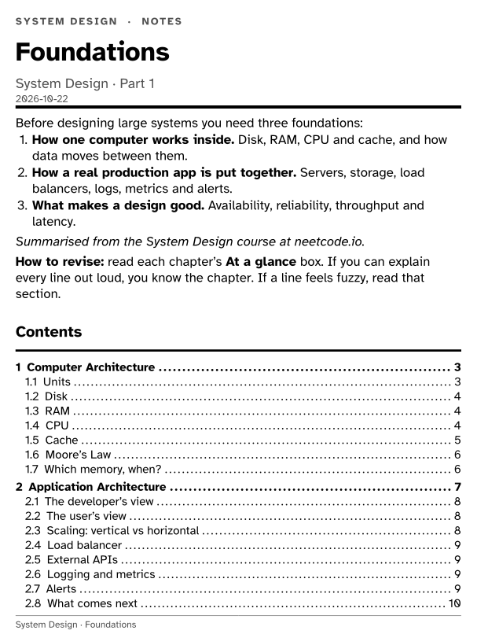
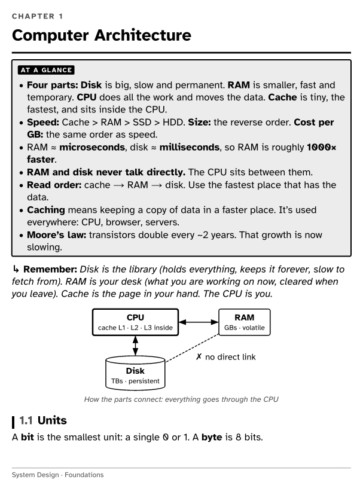
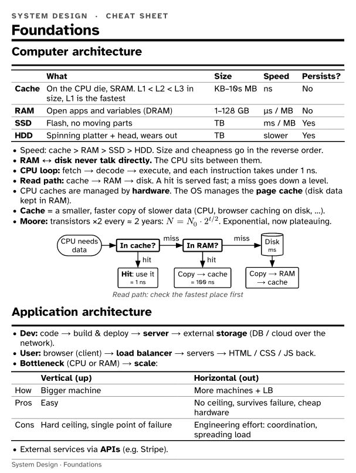

# 7-inch e-ink notes

Turn study material into notes made for **7-inch black & white e-ink readers** like the **Boox Go 7**: detailed main notes, dense cheat sheets with a diagram per section, and an **Anki** deck for retrieval practice.

You paste your material (text, photos of handwritten notes and diagrams, your own remarks) into an AI coding agent such as [Claude Code](https://claude.com/claude-code). The agent writes the notes in [Typst](https://typst.app), checks every page, and builds files you can send straight to your e-reader.

<table>
  <tr>
    <td></td>
    <td></td>
    <td></td>
  </tr>
  <tr>
    <td align="center"><sub>Cover: intro + contents</sub></td>
    <td align="center"><sub>Chapter: "At a glance" + diagram</sub></td>
    <td align="center"><sub>Cheat sheet: notes + flowchart</sub></td>
  </tr>
</table>

Download the finished examples from [`examples/`](examples/) and open them on your device.

## Features
- **Sized exactly to the screen**: 1264×1680 (Boox Go 7), so there's no zooming or panning. Pages are drawn at 2× size, so readers that render at a fixed DPI stay sharp.
- **Made for black & white e-ink**: structure comes from borders, bold and labels instead of colour. It uses a high-legibility font ([Atkinson Hyperlegible](https://brailleinstitute.org/freefont)) and grayscale code highlighting.
- **Main notes built for recall**: a cover page with an intro and contents, an *At a glance* box for each chapter, memory hooks and mnemonics, tables, and redrawn diagrams. Headings become the PDF outline, so your reader's table of contents works.
- **Cheat sheets**: dense one-to-three-page summaries, where every section ends with a flowchart or diagram for very fast lookup.
- **Anki decks (`.apkg`)**: tap to import into AnkiDroid. Re-importing an updated deck updates your cards and keeps your progress.
- **Maths, code, tables and diagrams**: Typst maths, syntax-highlighted code, and [fletcher](https://typst.app/universe/package/fletcher) diagrams.
- **A4 copy on request**: `A4=1 ./build.sh <file>` also writes a normal A4 version for printing or desktop reading.
- **Learns your taste**: tell the agent "smaller text" or "fewer boxes" and it records the preference in `STYLE.md`, so every future note follows it.

## Quick start
Requirements: Linux or WSL (x86_64), Python 3, and an AI coding agent such as [Claude Code](https://claude.com/claude-code) for the paste-and-go workflow.

```bash
git clone https://github.com/ASR222/7inch-eink-notes.git
cd 7inch-eink-notes
./setup.sh
```

`setup.sh` installs Typst to `~/.local/bin`, creates a Python venv with `genanki` and `markdown`, downloads the Typst diagram packages, and creates a local `CLAUDE.md` (gitignored) that points Claude Code to `AGENTS.md`.

Then start your agent in the folder and paste something to study:

> Subject: Operating Systems. Topic: Processes vs threads. *(paste text / photos / remarks)* Make all three.

The agent follows [`AGENTS.md`](AGENTS.md) and [`STYLE.md`](STYLE.md): it writes the files, checks the rendered pages, and builds:

```
out/<Subject>/<Topic> - Main.pdf
out/<Subject>/<Topic> - Cheat Sheet.pdf
out/Anki/<Subject>/<Topic>.apkg
```

**Optional:** to have every build also copied somewhere handy, such as a Windows folder under WSL, create an untracked `local.env`:

```bash
echo 'BOOX_OUT="/mnt/c/Users/<you>/Documents/Boox Notes"' > local.env
```

## Without an agent
Everything is plain files, so you can write notes by hand:

- **Notes:** `notes/<Subject>/<Topic> - Main.typ` and `- Cheat Sheet.typ`. Start from [`notes/DSA/`](notes/DSA/) or [`notes/System Design/`](notes/System%20Design/). The building blocks are in [`template/boox.typ`](template/boox.typ):
  - with a box: `#glance`, `#defn`, `#key`, `#formula`, `#pitfall`, `#mine`
  - without a box: `#example`, `#hook`, `#qa`, `#fig`
- **Anki cards:** `anki/<Subject>/<Topic>.cards.md`, in this format:
  ```
  deck: DSA::Binary Search
  tags: dsa binary-search

  Q: Why is binary search $O(\log n)$?
  A: Each step halves the search space.
  ```
- **Build:**
  ```bash
  ./build.sh                       # everything
  PREVIEW=1 ./build.sh "<file>"    # also PNG pages in preview/ at screen resolution
  ```

## Other screen sizes
The page size is set at the top of [`template/boox.typ`](template/boox.typ). Set `screen-w` and `screen-h` to **2× your screen's physical size**, which is `pixels / ppi × 25.4 mm × 2`. The Go 7 is 1264×1680 at 300 ppi, giving `214.04mm × 284.48mm`. Other 7" Carta readers, such as the Kobo Libra or Kindle Paperwhite, have a similar shape and should work almost as they are.

## Getting files onto a Boox
- **BOOXDrop (wireless):** on the Boox, open **BooxDrop**. On your PC, open the address it shows (same Wi-Fi), or go to **send.boox.com** and log in with your Boox account. Drag the files in.
- **USB-C cable:** the Boox shows up as a drive. Copy the subject folders into `Books/Study Notes/`.

**Shelves:** in the Boox Library, create a **Collection** for each subject (long-press a book → *Add to collection*), or switch the Library to folder view. Menu names vary a little between firmware versions.

**Highlighting:** in NeoReader, long-press a word, drag to select, then tap *Highlight*.

## Anki: a beginner's guide
Anki shows you a question, you try to remember the answer, then you rate how it went. It schedules each card just before you would forget it. Ten minutes a day is enough.

**Setup (once):**
1. On the e-reader, install **AnkiDroid** from the Play Store.
2. (Recommended) Make a free **AnkiWeb** account, then tap *Sync* in AnkiDroid. Your progress is backed up, and you can also review on your phone or PC.
3. For e-ink: in AnkiDroid *Settings → Appearance*, pick a light theme. On a Boox, open the **E-ink Center** for AnkiDroid and choose *Balanced* or *Speed* refresh.
4. Deck options (⚙ next to the deck): turn on **FSRS**, the newer, smarter scheduler, and keep *New cards/day* around **10–20**.

**Importing a deck:** send the `.apkg` file to the device and tap it, or in AnkiDroid use *⋮ → Import*.

**Daily use:**
1. Open AnkiDroid and tap a deck.
2. Read the question and **answer it in your head first**. This is the step that makes it stick.
3. Tap *Show answer*, then rate yourself:
   - **Again** if you got it wrong.
   - **Good** if you got it right. Use this most of the time.
   - Use *Hard* and *Easy* rarely.
4. Do your reviews every day. Missing days makes them pile up.

## Project layout
| Path | What |
|---|---|
| `AGENTS.md` | Workflow instructions for your AI agent (not needed if you write notes by hand) |
| `STYLE.md` | Style preferences and layout rules. It grows as you give feedback. |
| `.claude/skills/boox-notes/` | Claude Code skill that triggers when you paste study material |
| `template/` | Typst page template, building blocks and grayscale code theme |
| `anki/build_anki.py` | Turns `.cards.md` files into `.apkg` decks |
| `build.sh`, `setup.sh` | Build script and one-time setup |
| `notes/`, `anki/` | Note and card sources |
| `examples/`, `docs/` | Prebuilt example files and README screenshots |

## Roadmap
More note formats and features are planned. Ideas and pull requests are welcome, especially templates for other e-readers.

## Credits & licenses
- Code and template: [MIT](LICENSE).
- [Atkinson Hyperlegible](https://brailleinstitute.org/freefont) by the Braille Institute: SIL Open Font License ([`fonts/OFL.txt`](fonts/OFL.txt)).
- Built with [Typst](https://typst.app), [fletcher](https://typst.app/universe/package/fletcher), [CeTZ](https://typst.app/universe/package/cetz) and [genanki](https://github.com/kerrickstaley/genanki).
- The System Design example is a summary of the System Design course at [neetcode.io](https://neetcode.io), shared to demonstrate the format.
